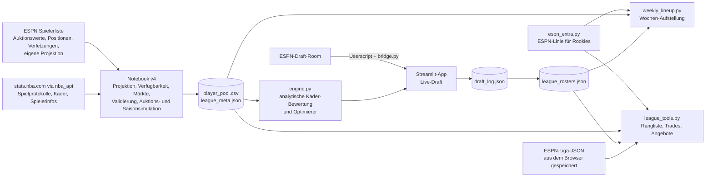

# NBA-Fantasy-Werkzeugkasten für „Swiss See Ballers“

Daten holen, Spieler projizieren, die Auktion live begleiten, danach Wochen-Aufstellung und Trades. Gebaut für eine
ESPN-Liga (H2H *each category*, 14 Teams, \$200-Salary-Cap-Auktion, Saison 2026-27), im Kern aber auf jede Liga dieser Art übertragbar.
Dieses README erklärt **was** die Werkzeuge tun, **warum** sie es so tun (Theorie), **was gemessen wurde** (Befunde)
und **was entschieden wurde** (Entscheidungslog). Alle Zahlen stammen, wo nichts anderes steht, aus dem letzten vollständigen Lauf von
`fantasy_draft_2026_27_v4_engine.ipynb` (Ausgaben im Notebook gespeichert) oder aus den genannten Skripten; stammt eine Zahl aus einem früheren Lauf oder einem einmaligen Skript, steht das dabei. Stand: 18. Oktober 2026.

> Das Paket `src/nba_api` ist der unveränderte Client von [swar/nba_api](https://github.com/swar/nba_api) (MIT-Lizenz) und dient als Datenquelle
> (Abschnitt 14). Alles andere in diesem Repo ist der Fantasy-Teil.

## Inhalt

1. [Überblick](#1-überblick) · 2. [Einrichtung und Schnellstart](#2-einrichtung-und-schnellstart) · 3. [Repo-Aufbau](#3-repo-aufbau) · 4. [Die Liga](#4-die-liga)
5. [Daten](#5-daten) · 6. [Methodik und Theorie](#6-methodik-und-theorie) · 7. [Befunde](#7-befunde) · 8. [Entscheidungslog](#8-entscheidungslog)
9. [Annahmen, Grenzen, bekannte Auffälligkeiten](#9-annahmen-grenzen-bekannte-auffälligkeiten) · 10. [Betrieb im Detail](#10-betrieb-im-detail) · 11. [Tests](#11-tests)
12. [Datenschutz und Sicherheit](#12-datenschutz-und-sicherheit) · 13. [Offene Fragen](#13-offene-fragen) · 14. [Herkunft, Lizenz, Verlauf](#14-herkunft-lizenz-verlauf)

---

## 1. Überblick

**Kernidee.** In einer H2H-Kategorien-Liga gewinnt man eine Woche, wenn man mindestens 6 von 10 Kategorien holt. Alles andere im Boxscore zählt nicht.
Statt vorab eine Kategorie-Strategie zu wählen („welche Kategorien punte ich?“), optimiert das System **direkt die Wahrscheinlichkeit, einen Wochen-Matchup zu gewinnen**,
und liefert zu jedem Spieler einen *Break-even-Preis*: das Maximum, das man für ihn zahlen darf und trotzdem einen Kader hält, der so gut ist wie der beste Kader ohne ihn.



Was das System **nicht** ist: ein Orakel. Die Projektionen sind Schätzungen, die absoluten Gewinnchancen sind optimistisch (Abschnitt 9). Belastbar ist vor allem der **Vergleich**
zwischen Kadern, Strategien und Trades.

---

## 2. Einrichtung und Schnellstart

Voraussetzung: Python ≥ 3.10. Auf Apple Silicon eine native Umgebung nehmen (eine x86-conda-Umgebung läuft ohne Rosetta nicht).

```bash
python3 -m venv .venv
.venv/bin/python -m pip install -e ".[fantasy,dev]"     # nba_api (aus src/), streamlit, certifi, pytest, nbconvert, ipykernel
.venv/bin/python -m pytest                              # 62 Tests, ohne Netzwerk
```

| Aufgabe | Befehl |
|---|---|
| Daten holen, projizieren, Pool exportieren (rund 9 Minuten, danach zwischengespeichert in `cache/`) | `.venv/bin/python -m nbconvert --to notebook --execute --inplace fantasy_draft_2026_27_v4_engine.ipynb` |
| Draft-Abend starten (Verletzungen aktualisieren, ESPN-Empfänger, App auf `http://localhost:8502`) | `./draft_app/start_draft_night.sh` (`--reset` leert vor dem echten Draft das Log) |
| Aufstellung für Matchup-Woche N | `./draft_app/weekly.sh N` oder `./draft_app/weekly.sh --opponent "Teamname"` |
| Alle Kader aktualisieren, Rangliste, Trade-Ideen | `./draft_app/league.sh all` |
| Jemand fragt nach deinem Spieler: was zurückverlangen? | `./draft_app/league.sh offer --team "Brick City" --asks "Jamal Murray"` |
| Du willst einen Spieler: Angebote, Stat-Veränderung, Nachricht | `./draft_app/league.sh want "Evan Mobley"` |
| ... mit Trade-Grösse (wie viele Spieler auf jeder Seite; `--get` zählt den Wunschspieler mit), ohne bestimmte Spieler anzubieten | `./draft_app/league.sh want "Evan Mobley" --give 2 --get 2 --keep "Jamal Murray;Devin Booker"` (Zahl oder Bereich 1–3, mehrere Wunschspieler mit `;`, `--skip` = nicht mitverlangen, `--top N` = Optionen je Kategorie) |

Die persönlichen Dateien (Liga-ID, Eigentümername, Kader, ESPN-Liga-Daten) liegen nur lokal und sind in `.gitignore` (Abschnitt 12). Für die Liga-Werkzeuge braucht es
`draft_app/local_config.json` mit `{"league_id": <ID aus der ESPN-URL>, "owner_names": ["<Name im Draft-Room>"]}`.

---

## 3. Repo-Aufbau

| Pfad | Zweck |
|---|---|
| `fantasy_draft_2026_27_v4_engine.ipynb` | Die Datenpipeline: Spielprotokolle, Metadaten, Kader, ESPN-Daten, Projektion, Verfügbarkeit, Marktkurven, Simulatoren, Validierung, Export für die App |
| `draft_app/engine.py` | Analytische Kader-Bewertung (Wochen-Mittel und -Varianz), P(Kategorie), P(Matchup), Optimierer, Break-even-Gebote, Bank-Vorschläge, Preisniveau |
| `draft_app/auction_sim.py` | Auktionssimulator mit 14 Bietern, Bootstrap-Wochensimulator aus echten Spielen, Marktkurven |
| `draft_app/app.py` | Streamlit-Oberfläche für den Draft-Abend |
| `draft_app/bridge.py`, `espn_bridge.user.js` | Lokaler Empfänger und Tampermonkey-Userscript, das den ESPN-Draft-Room mitliest |
| `draft_app/availability.py`, `refresh_injuries.py` | ESPN-Verletzungsstatus holen und in erwartete Spiele übersetzen |
| `draft_app/names.py` | Namensabgleich ESPN ↔ Pool (akzentfrei, ohne Suffixe) |
| `draft_app/weekly_lineup.py`, `weekly.sh` | Wochen-Aufstellung: Spielplan, Spielzahlen je Team, beste legale Zehn |
| `draft_app/league_tools.py`, `league.sh` | Kader aller Teams aktualisieren, Rangliste mit Siegchancen, Trade-Vorschläge, Angebote, Wunschspieler |
| `draft_app/espn_extra.py` | ESPNs eigene Projektion für Spieler ohne NBA-Daten (Rookies, Neuzugänge) |
| `draft_app/start_draft_night.sh` | Startet Empfänger und App |
| `draft_app/tests/` | 62 Tests: Engine, Endspiel, Bank, Verfügbarkeit, Bridge, Wochen-Aufstellung, Liga-Werkzeuge, ESPN-Ersatzlinien |
| `src/nba_api/` | Datenclient (Upstream swar/nba_api, wird editierbar installiert) |
| `pyproject.toml` | Paket-Metadaten und Extras (`fantasy`, `dev`) |

Entfernt am 18. Oktober (alles weiterhin in der Git-Historie, Tag `archive/pre-cleanup`): die Upstream-Entwicklungsumgebung (Dokumentation, Bibliothekstests, Generatoren,
CI), die früheren Notebooks `get_data` (erster Datenabzug), v1, v2 und v3 sowie `REPORT.md`, dessen Inhalt in dieses README überging. Begründung in Abschnitt 8, Eintrag E22.

---

## 4. Die Liga

| Regel | Wert |
|---|---|
| Format | ESPN, H2H *each category*, Saison 2026-27, Auktion am 17. Oktober 2026 (abgeschlossen) |
| Teams | 14, \$200 Budget je Team, Mindestgebot \$1, Topf \$2'800 |
| Kader | 13 Plätze: PG, SG, SF, PF, C, G (PG/SG), F (SF/PF), 3× UTIL = 10 Starter, dazu 3 Bank; kein IR; maximal 4 Center |
| Aufstellung | wöchentlich, gesperrt zum ersten Spiel der Woche; keine Protection |
| Kategorien | FG%, FT%, 3PM, REB, AST, STL, BLK, DD, PTS, PPM (Punkte pro Minute); keine Turnovers |
| Matchup | 6 von 10 Kategorien gewinnt; 5:5 zählt als halber Sieg (Annahme, siehe F1) |
| Saison | 18 Wochen (20. Oktober bis 28. Februar), danach Playoffs (Top 4) |
| Sonstiges | Pures Redraft, keine Keeper; FAAB-Budget \$100; höchstens 7 Käufe pro Matchup |

Die Regeln stehen an **einer** Stelle (Zelle 2 des Notebooks) und gehen von dort in `league_meta.json` und damit in alle Werkzeuge. Ändert sich eine Regel, ändert man sie nur dort.
Ratio-Kategorien (FG%, FT%, PPM) zählen als Team-Aggregat ΣZähler/ΣNenner, nicht als Mittel von Prozentwerten.

---

## 5. Daten

**Quellen.**

| Quelle | Inhalt | Zugriff |
|---|---|---|
| stats.nba.com über `nba_api` | `LeagueGameLog` (Spielprotokolle, vier Saisons 2022-23 bis 2025-26), `CommonPlayerInfo` (Alter, Grösse, Geburtsdatum), `CommonTeamRoster` (Kader 2026-27), `ScheduleLeagueV2` (Spielplan) | öffentlich, drosselt Anfragen: gestaffelt mit Pausen, Zwischenspeicher in `cache/` |
| ESPN Fantasy, Spielerliste (`lm-api-reads.fantasy.espn.com/apis/v3/games/fba/seasons/2027/players?view=kona_player_info`) | Auktionswerte, Positions-Berechtigung (`eligibleSlots`), Verletzungsstatus, ESPN-Rang für H2H-Kategorien, **eigene Projektion** (Statistik-Quelle `102027`) | öffentlich, kein Login |
| ESPN Liga-Daten (`.../leagues/<ID>?view=mRoster&view=mTeam`) | Kader aller Teams, Teamnamen | nur eingeloggt (ohne Login HTTP 401); der Weg ohne Zugangsdaten im Werkzeug ist „Seite im eingeloggten Browser speichern“ (Abschnitt 10.4) |
| ESPN-Draft-Room (Browser) | aufgerufener Spieler, Gebot, Verkäufe | Userscript liest nur mit (Abschnitt 10.2) |

Beide inoffiziellen Schnittstellen können sich ohne Ankündigung ändern.

**Spielerpool.** Aus den Protokollen 2025-26 und 2024-25 entsteht der Pool der draftbaren Spieler:

* **normal** (369): mindestens 15 Spiele und 12 Minuten pro Spiel in 2025-26.
* **previous season only** (7): verletzte Rückkehrer ohne qualifizierende Saison 2025-26 (z. B. Haliburton, Irving, Lillard), projiziert aus 2024-25 mit niedriger Verfügbarkeit (0.46–0.49).
* **ESPN-only (proxy line)** (6): Rookies ohne einen NBA-Einsatz, die ESPN preist. Sie bekommen für das Draft-Log eine Ersatzlinie des Spielers, dessen Modellwert dem erwarteten Preis am nächsten
  liegt, sind mit `MODEL_OK = False` markiert und werden im Draft **nie** empfohlen (sie existieren, damit ein aufgerufener Rookie sich eintragen lässt und die Geldbilanz stimmt).
  Nach dem Draft ersetzt `espn_extra.py` diese Zeilen in den Liga-Werkzeugen durch ESPNs eigene Linie (Abschnitt 6.12).
* Entfernt: 28 Spieler, die auf keinem NBA-Kader 2026-27 stehen (Ruhestand, ohne Vertrag).

Namensabgleich: ESPN schreibt „Nikola Jokic“, der Pool „Nikola Jokić“. Verglichen wird auf einem akzentfreien, interpunktionsfreien, suffixfreien Schlüssel (`names.name_key`).
Schlüssel, die zwei verschiedene Spieler teilen, werden verworfen, nie geraten.

---

## 6. Methodik und Theorie

### 6.1 Projektion pro Spiel

Für jeden Spieler und jede Kennzahl `x` ∈ {MIN, PTS, REB, AST, STL, BLK, 3PM, FGM, FGA, FTM, FTA, DD} wird ein Mittelwert pro Spiel in vier Schritten gebildet.

1. **Saisonmix.** `m = 0.7 · Mittel(2025-26) + 0.3 · Mittel(2024-25)`; fehlt die Vorsaison, zählt nur 2025-26. Ein Backtest über mehrere Saisons lag mit seinem Optimum bei 0.75–0.8 und ist dort flach,
   0.7/0.3 wurde deshalb beibehalten.
2. **Alterskurve.** Multiplikativer Faktor auf alle Mittelwerte (nicht auf die Streuung): 1.14 (unter 21), 1.09 (unter 23), 1.04 (unter 25), 1.00 (bis 28), 0.97 (bis 30), 0.93 (bis 32), 0.88 (bis 34), 0.91 (ab 35).
   Die frühere Kurve hatte −20 % ab 35; der empirische Alterseffekt rechtfertigt nur −9 %. Auffälligkeit der Stufen 33–34 gegen 35+: Abschnitt 9, Punkt 8.
3. **Teamumfeld nach *Veränderung*.** Für jeden Spieler wird die Stärke seiner Mitspieler im neuen Team mit der im alten Team verglichen.
   Stärke eines Spielers = Summe der z-Werte von PTS, REB, AST, STL, BLK, 3PM der Vorsaison. `MATES_NEW` / `MATES_OLD` = Summe der Stärken der Teamkollegen (ohne den Spieler selbst),
   `MATES_DELTA = (MATES_NEW − MATES_OLD) / sd(MATES_NEW)`. Jede Kennzahl wird mit `clip(1 − β_x · MATES_DELTA, 0.85, 1.15)` multipliziert; β je 1 sd: PTS, FGM, FGA, FTM, FTA 0.07 · AST 0.06 · 3PM 0.05 ·
   BLK 0.05 · STL 0.04 · DD 0.04 · REB 0.03. Mehr Starpower um den Spieler heisst im Mittel weniger eigene Produktion (Usage).
   **Warum Veränderung statt Niveau:** In einer Regression über rund 130 Teamwechsler erklärt die Veränderung 3.6-mal so viel Varianz (R² 0.067 gegen 0.018), und sind beide im Modell, ist der Koeffizient des Niveaus +0.006, also null.
   Ein Spieler, dessen Umfeld sich nicht ändert, trägt dieses Umfeld bereits in seinen Vorjahreszahlen; es ein zweites Mal anzurechnen (frühere Fassung: Jokić +12 %) wäre eine Doppelzählung.
4. **Mischung mit ESPNs Projektion, 50/50.** Danach wird jeder Mittelwert mit ESPNs eigener Projektion gemittelt: `m_final = 0.5 · m_Modell + 0.5 · m_ESPN` (`ESPN_BLEND_W = 0.5`; 0 schaltet sie ab). ESPN liefert die Projektion für 348 Spieler, für alle anderen gilt nur das Modell.
   Die Spielzahl bleibt die des Modells (ESPN ist optimistisch, Jokić 72 Spiele, und kennt die Verletzungsbehandlung nicht). ESPN liegt im Mittel rund 4 % über dem Modell (PTS +0.26 pro Spiel nach der Mischung)
   und deutlich bei Spielern mit verletzungsgeprägter Vorsaison (Giannis, Davis, Young, Siakam), bei denen das Modell zu 70 % auf wenigen Spielen 2025-26 ruht; die Mischung dämpft das.
   **Nicht geprüft** ist, ob die Mischung besser vorhersagt; das liesse sich erst mit der Saison messen. 50 % ist eine Vorgabe, kein Messwert.

**Double-Doubles (DD).** ESPN zeigt für jeden Spieler 0.0. Deshalb wird die DD-Rate aus der Stat-Linie abgeleitet: eine logistische Regression
`P(DD) = σ(b·f)` mit Merkmalen aus den sortierten Mittelwerten von PTS, REB, AST, STL, BLK (geteilt durch 10): `f = (1, s1, s2, s3, s2², s1·s2, s2³)`, angepasst an 1'545 Spieler-Saisons aus vier Saisons
Spielprotokollen (Fehler ausserhalb der Stichprobe rund 0.03 bei einer Streuung von 0.155 zwischen Spielern). Dieser Wert wird wie die anderen Zahlen mit dem Modell-DD gemittelt.

### 6.2 Verfügbarkeit

Erwartete Spiele sind nicht „Spiele der letzten Saison“. Ein Test an vier Saisons (513 Rotationsspieler-Saisons, mindestens 20 Spiele und 18 Minuten in der Vorsaison, Ziel: Spiele der Folgesaison) ergab:

| Vorhersage der Folgesaison-Spiele | RMSE (kleiner = besser) |
|---|---|
| dieselbe Zahl für alle (Mittel 57.7 von 82) | 0.230 |
| Mittel der letzten zwei Saisons (frühere Fassung) | **0.263** (schlechter als die Konstante) |
| kalibrierte Regression | 0.219 |

Wer im Vorjahr 75+ Spiele hatte, spielte im Folgejahr im Schnitt 63; wer unter 30 hatte, 48. Spielzeit persistiert nur schwach. Die Verfügbarkeit ist deshalb

```
AVAIL = clip( 0.392 + 0.331·GP₁/82 + 0.067·GP₂/82 + 0.028·(MPG₁−25)/10 − 0.020·max(Alter−30, 0)/5 + 0.042·[Alter<23],  0.30, 0.95 )
```

(GP₁ / GP₂ = Spiele der letzten / vorletzten Saison). Die Streuung der Verfügbarkeit im Pool beträgt 0.09 (Mittel 0.67, Spanne 0.42–0.84); die frühere Fassung hatte 0.17 (Spanne 0.20–1.00), also rund doppelt so breit.
Produktion ist **linear** in gespielten Spielen; der frühere Exponent 1.35 auf die Verfügbarkeit entfiel.

**Verletzungs-Overlay** (`availability.py`). Steht ein Spieler bei ESPN auf OUT (oder `injured`), werden `OUT_GAMES_LOST = 25` Spiele abgezogen (Untergrenze 0.12). **Das ist eine Annahme, keine Messung.**
`DAY_TO_DAY` und alle anderen Stati ändern nichts (82 Spieler, zu häufig, um etwas zu bedeuten). Manuelle Vorgaben `availability_overrides.json` {Name → erwartete Spiele} gewinnen immer.

### 6.3 Streuung pro Spiel

Neben jedem Mittelwert steht die Standardabweichung pro Spiel (`S_PTS`, `S_REB`, … `S_DD` aus den Spielprotokollen). Für die Quoten gibt es die Streuung der *Impact-Grösse* (`SI_FG`, `SI_FT`, `SI_PPM`, siehe 6.4).
Die Streuung wird nicht mit dem Alter skaliert (Alter bewegt die Produktion, nicht die Varianz).

### 6.4 Das Wochenmodell: alles ist eine Summe über zehn Starter

Wochensumme einer Zählkategorie = Summe über die Starter. Mit `g` Teamspielen in der Woche und Verfügbarkeit `a` ist die Zahl gespielter Spiele eines Spielers binomial.
Ist die Zahl der Teamspiele selbst unsicher (Saisondurchschnitt, 3.45 Spiele je Woche), kommt deren Varianz dazu. Je Spieler und Kategorie:

```
E[Woche]   = E[G] · μ                         E[G] = g·a
Var[Woche] = E[G] · σ² + Var[G] · μ²          Var[G] = g·a·(1−a) + 4·p·(1−p)·a²,   p = g/4   (Saisondurchschnitt)
                                              Var[G] = g·a·(1−a)                                (bekannte Woche, Teamspiele fest)
```

(Zusammengesetzte Verteilung: `μ`, `σ` pro Spiel.) Teamsumme: Erwartungswerte und Varianzen addieren sich über die Starter.

**Quoten als Impact.** FG%, FT% und PPM sind Team-Aggregate. Ein Spieler beeinflusst sie in Proportion zu seinen Versuchen, nicht zu seiner Quote. Deshalb wird je Spieler der *Impact*
`I = Zähler − Liga-Quote · Nenner` geführt (z. B. `FGM − 0.473·FGA`, `FTM − 0.785·FTA`, `PTS − 0.486·MIN`), summiert, und die Teamquote ist `Liga-Quote + ΣI / ΣNenner`.
Ein 92-%-Schütze mit 1 Freiwurfversuch pro Spiel bewegt Team-FT% kaum; das wird so richtig abgebildet (und die naive z-Wertung nach Rohprozent war falsch).

### 6.5 Gegner-Benchmark und P(Kategorie)

Beim Draft gibt es noch keinen Gegner, deshalb ein Benchmark („Feld“): aus den 13 anderen Kadern der Mittelwert `μ_F` der Team-Mittel, die mittlere Wochen-Streuung `σ_F` und die Streuung der Team-Mittel zwischen den Teams `τ`
(manche Gegner sind schlicht besser). Dann:

```
P(Kategorie c gewinnen) = Φ( (μ_c − μ_F,c) / √( σ_c² + σ_F,c² + τ_c² ) )
```

Für einen konkreten Gegner (Wochen-Aufstellung, Liga-Werkzeuge) entfällt `τ`: `Φ( (μ_A − μ_B) / √(σ_A² + σ_B²) )`.

### 6.6 P(Matchup): Poisson-Binomial, Remis, Kalibrierung

* **Poisson-Binomial.** Aus den zehn Wahrscheinlichkeiten `p_c` folgt die Verteilung der gewonnenen Kategorien (unabhängig angenommen), exakt per Dynamik in einem Durchlauf.
* **Remis.** 5:5 zählt als halber Sieg: `P(Matchup) = P(≥ 6) + 0.5 · P(= 5)`.
* **Korrelation korrigieren.** Kategorien bewegen sich in einer Woche zusammen (eine rebound-starke Woche ist auch DD-stark). Das Produkt unabhängiger Wahrscheinlichkeiten ist zu extrem: schwache Teams wirken schlechter,
  starke besser. Gegen den Bootstrap-Simulator (90 Kader) gilt `logit(P_sim) = b · logit(P_roh)`; ausgeliefert ist `b = 0.66` (CAL_B), der Lauf des Notebooks ergab zuletzt 0.608, ein früherer 0.655. Fehler nach
  Kalibrierung RMSE 0.016 (unkalibriert 0.085). **Der Achsenabschnitt ist bewusst 0:** Ein Team, das so gut ist wie das Feld, muss 50 % haben. Die Abbildung ist monoton und ändert nie, welcher von zwei Kadern besser ist.

### 6.7 Bewertung und Marktpreise

* **Volumengewichtete z-Werte.** Pro Kategorie wird der Impact (6.4) standardisiert; die Summe aller zehn z-Werte, gewichtet mit der Verfügbarkeit (linear), ist der „Modellwert“ eines Spielers.
* **Wert über Ersatz → Dollar.** Ersatzniveau = Wert des 182. besten Spielers (14 Teams × 13 Plätze); der Topf nach Mindestgeboten wird proportional zum Wert über Ersatz verteilt (`MODEL_$`).
* **Drei Marktkurven**, weil der wahre Preisverlauf dieser Liga vorab unbekannt ist und der beste Kategorie-Plan mit der Kurve wechselt (7.1):
  * `UNIFORM`: ESPNs Werte gleichmässig gestreckt, bis die Top 182 den Topf \$2'800 ergeben (Jokić: ESPN \$88 → \$123).
  * `STRUCTURAL`: ESPNs Werte folgen einer Kurve für rund 10 Teams (die Top 130 summieren sich auf rund \$1'830 von \$2'000, ab Rang 131 etwa \$0; die Top 182 auf \$2'077). Mit 14 Teams werden die Ränge 100–182 zu Startern: das Mittelfeld steigt stark,
    die Stars nur 10–20 % (Jokić \$105). Der Aufschlag hängt vom *ESPN-Rang* ab, nicht vom eigenen Modellrang (ESPN bezahlt zum Beispiel Siakam wie einen Top-10-Spieler).
  * `MODEL`: der Wert-über-Ersatz-Preis der eigenen Bewertung ohne ESPN-Information (Jokić \$70).
  Das Board der App zeigt `STRUCTURAL` (`MARKET_MODEL`), die anderen Kurven bleiben als Spalten erhalten.
* **ESPN preist für 9-Kategorien, diese Liga zählt DD und PPM.** Rebounding-Center, die REB, DD und FG% gleichzeitig liefern, sind bei ESPN so bepreist, als wären Double-Doubles nichts wert: ein struktureller Rabatt, den der Raum von ESPN erbt.

### 6.8 Der Optimierer

Gesucht ist der beste legale Startkader unter Budget. Weil Mittel und Varianz additiv sind, ist ein Tausch eine Vektoraddition, und **alle** Tauschmöglichkeiten werden in einem numpy-Aufruf bewertet.

1. **Lagrange-Preis aufs Budget.** Maximiert wird `f(Kader) − λ·Kosten`. `λ` (Gewinnwahrscheinlichkeit pro Dollar) wird per Bisektion so lange verändert, bis der Kader gerade ins Budget passt.
2. **Lokale Suche.** Steilster Anstieg über Einzeltausch; drei Startpunkte (Greedy-Seeds mit Preis-Exponent α ∈ {0, 0.6, 1}); am Ende ein Politur-Schritt, der bei hartem Budget jeden verbleibenden Verbesserungs-Tausch nimmt.
3. **Rechtlichkeit.** Typisierte Positionsplätze werden per augmentierendem Pfad (Kuhn-Zuordnung) belegt; höchstens 4 Center im Gesamtkader (Center auf der Bank zählen mit).
4. **Break-even-Gebot.** Für Spieler `j` und den zu ersetzenden Starter `k` gilt `p_j ≤ Preis_k + Δf/λ`. Das Maximum über alle *legalen* `k` ist der Break-even-Preis; gedeckelt durch Restbudget minus \$1 je offenem Slot.
   Für Spieler im Zielkader gilt dasselbe gegen den besten Ersatz (der Preis, ab dem er nicht mehr lohnt).
5. **Robust bis zum Schluss** (`solve_robust`). Spät in der Auktion können Prognosepreise über dem liegen, was ein fast leeres Portemonnaie bezahlen kann (z. B. \$8 für 8 offene Slots). Das Mindestgebot ist \$1, also ist ein Kader zu Mindestpreisen immer bezahlbar:
   die Prognosepreise werden Richtung Mindestgebot skaliert, bis ein legaler Kader entsteht (`scale` 1.0 = Prognose, 0.0 = alles zu \$1); als letzter Ausweg füllt `_emergency_fill` budgetblind, aber positions- und center-legal.

### 6.9 Preisniveau während der Auktion

Geldbilanz: Alles Restgeld im Raum wird für die noch offenen Spieler ausgegeben. Die Prognose wird so skaliert, dass die wahrscheinlichsten Käufe (die `slots_left` höchstbewerteten verbleibenden Spieler) genau das Restgeld kosten.
Nur Teams mit offenen Kaderplätzen zählen (Teams mit vollem Kader geben nichts mehr aus). Zusätzlich lernt `live_prices` einen Preisformfaktor je Preisstufe (<8, 8–20, 20–50, 50+); dieser wurde getestet und **bringt nichts**
(im letzten Lauf mit Preisstufen 0.852 gegen 0.860 und 0.867 gegen 0.873 ohne, also eher schlechter als besser), bewegt deshalb die Gebote nicht und wird nur angezeigt. Das Niveau-Lernen genügte selbst bei falsch geglaubter Marktkurve.

### 6.10 Bank

Ohne IR und mit gesperrter Wochenaufstellung bleibt der Platz eines ausgefallenen Starters leer, wenn niemand einspringt. Für Starter `s` mit Gewicht `W_s = 1 − AVAIL_s` wird die Matchup-Chance der Aufstellung ohne `s`
mit der Aufstellung mit Kandidat `c` an dessen Stelle verglichen (Positionen und Center-Limit müssen passen). Der Wert von `c` ist `Σ_s W_s · [p(Team − s + c) − p(Team − s)]`.
Die drei Bankplätze werden gierig so gewählt, dass sie *verschiedene* Starter abdecken; ein späterer Kandidat zählt, was er über `overlap = 0.5` des bereits Abgedeckten hinaus bringt (eine Annahme: mit rund drei fehlenden Startern gleichzeitig
sind Bankspieler meist gleichzeitig gefragt). Das ist eine Rangfolge erster Ordnung, keine Gewinnprognose; die App zeigt einen relativen Index.

### 6.11 Simulation und Validierung

* **Bootstrap-Wochensimulator** (`auction_sim.bootstrap_weeks`). Jedes Spiel eines Spielers wird gemeinsam resampled (FGM bewegt sich mit FGA; ein Double-Double *ist* ein Spiel mit zwei grossen Zahlen) und auf seine projizierten Mittel skaliert; Spiele pro Woche sind
  Binomial(Teamspiele, Verfügbarkeit). Der frühere Simulator zog jede Boxscore-Grösse unabhängig normalverteilt und erzeugte dadurch FT%-Streuung 5.1-mal und FG%-Streuung 2.0-mal zu hoch (7.1).
* **Validierung der Engine.** 90 Kader (zufällig gute Spieler, starke Kader, Optimierer-Kader) werden von Engine und Simulator bewertet: erwartete Kategorien Korrelation 0.9996, RMSE 0.113; P(Matchup) nach Kalibrierung RMSE 0.016.
* **Umkämpfte Auktion** (`auction_sim.run_trial`). Gleichzeitige englische Auktion mit 14 Bietern, Auflösung bei Zweithöchstem + \$1, rotierende Nominierung, Preise, die sich mit Geld und Talent im Raum bewegen.
  Rivalen sind marktfolgende Bieter (3 mit Punt-Plan, der Rest bietet das ESPN-Board mit Rauschen). „Ich“ bin entweder der **Engine-Bieter** (bietet seinen Break-even-Preis und plant neu, wenn sich der Raum bewegt) oder ein **fester Plan**
  (Kategorien punten/anpeilen, nach z-Summe bewertet). Bewertet wird jeder gleich: P(Wochen-Matchup-Gewinn) gegen die 13 Kader, die aus *derselben* Auktion hervorgingen.
* **Stresstests.** Einige der 13 Rivalen bieten mit demselben Optimierer (jeder mit eigenem verrauschtem Preisglauben), und der Raum zahlt eine andere Kurve als die, die ich glaube.

### 6.12 Nach dem Draft

**Wochen-Aufstellung** (`weekly_lineup.py`). Für eine Woche und einen Gegner:

1. Spielplan über `ScheduleLeagueV2` (nur Regular Season); je NBA-Team die Zahl der Spiele von Montag bis Sonntag. Wegen der gesperrten Wochenaufstellung zählt ein Vier-Spiele-Spieler etwa doppelt so viel wie ein Zwei-Spiele-Spieler.
2. Erwartete Spiele je Spieler = Teamspiele × Verfügbarkeit (ESPN OUT zählt als 0.05); die Teamspiele sind bekannt, also `Var[G] = g·a·(1−a)` (6.4).
3. Kategorie-Momente beider Teams, `P(Kategorie)` gegen den konkreten Gegner (6.5), `P(Matchup)` wie in 6.6.
4. **Erschöpfende Suche** über alle `C(13, 10) = 286` Zehner-Aufstellungen, gefiltert auf legal (Positionsplätze, höchstens 4 Center); die mit der höchsten Siegchance gewinnt. Der Gegner spielt vermutlich sein bestes legales Zehner gegen ein neutrales Feld (geraten).
5. Ausgabe: Start/Bank mit Platz, Spielen, Wochensummen, Gewinnchance je Kategorie und die nächstbesten Änderungen (ein Starter gegen einen Bankspieler).

**Liga-Werkzeuge** (`league_tools.py`).

* **Kader aktualisieren (`refresh`).** Liest ESPNs Liga-JSON, schreibt `league_rosters.json`, behält den alten Schlüssel eines umbenannten Teams („Unsupervised Chaos“ ↔ „Team 15“), meldet Trades, Neuverpflichtungen und Entlassungen seit dem letzten Stand.
* **Aufstellungen der Teams.** Jedes Team spielt im Modell seine beste Zehner-Aufstellung: Start mit der z-Summe der erwarteten Wochenbeiträge, danach dreimal abwechselnd Feld neu berechnen und je Team per Hügelklettern (Starter gegen Bankspieler, legal) verbessern.
* **Rangliste.** Siegchance pro Woche = Mittel von `P(Matchup)` gegen jedes andere Team (6.5/6.6, ohne `τ`). Die Saison wird 3'000-mal simuliert: 18 Wochen mit zufälligen Paarungen (nicht dem echten Spielplan), Ergebnis je Paarung aus der Matchup-Wahrscheinlichkeit;
  daraus erwartete Siege, Top-4-Chance und Chance auf Platz 1. Das ist ein *Zustand-heute*-Modell mit durchschnittlichen Wochen; Verletzungen und Spielzahlen einzelner Wochen kommen nicht vor.
* **Trade-Bewertung.** Für „ich gebe `G`, ich bekomme `B`“ werden beide neuen Kader gebildet (bei ungleicher Anzahl wirft der Empfänger von mehr Spielern seinen schwächsten Bankspieler), beide Aufstellungen neu optimiert und beide Siegchancen
  sowie die Kategorie-Veränderungen berechnet. **„Fair“ ist eine Faustregel:** der Wert eines Spielers ist das Mittel aus ESPN-Listenwert und Draft-Preis (nur ESPN-Wert, wenn kein Draft-Preis bekannt ist);
  ein Angebot wirkt für den Manager fair, wenn er mindestens Wert minus \$3 bekommt.
* **`suggest`:** alle Ein-gegen-Eins-Trades mit allen Teams; gezeigt werden die Win-Win-Trades (mein Gewinn über +0.1 Pp, Partner nicht schlechter als −0.1 Pp) und die für den Manager fairen.
* **`offer`:** jemand fragt nach Spielern von dir; geprüft werden alle Einzelspieler und Zweierpakete des Managers, sortiert nach deinem Gewinn, nur faire Angebote, plus die modellbesten auch bei Wertverlust des Managers.
* **`want`:** du willst einen Spieler (oder mehrere vom selben Team) und legst fest, wie viele Spieler im Trade sein sollen: `--give` = wie viele du abgibst, `--get` = wie viele du bekommst (der Wunschspieler zählt mit, der Rest sind weitere Spieler des Partners), jeweils eine Zahl oder ein Bereich von 1 bis 3.
  `--keep` schützt eigene Spieler, `--skip` nimmt Spieler des Partners aus der Anfrage. Es werden alle passenden Trades durchgerechnet (beide Aufstellungen neu optimiert, Siegchance und Kategorien beider Teams) und in **drei Optionen** gezeigt, weil „der beste Trade“ davon abhängt, was man will:
  (1) *Beide profitieren*, sortiert nach dem kleineren der beiden Gewinne; (2) *Grösster Gewinn für dich*, solange die Siegchance des Managers um höchstens 1 Pp sinkt; (3) *Wirkt für den Manager fair*, also Wert nach ESPN-Liste/Draft-Preis mindestens Wert minus \$3 und höchstens 0.5 Pp Verlust.
  Ein Trade erscheint nur unter der ersten Option, die ihn aufnimmt, und Trades, die gegenüber einem kleineren nur Stücke ohne jede Wirkung hinzufügen (z. B. ein Bankspieler als Zugabe), werden verworfen. Zu jeder Option stehen die Stat-Zeilen aller Spieler, die Siegchance vorher/nachher für beide Teams und die wichtigsten Kategorie-Veränderungen;
  zur ersten Option kommen ein Nachrichtenentwurf und die Tabelle der erwarteten Wochensummen beider Teams vorher/nachher. Bei grossen Suchen (über 1'200 mögliche Trades, z. B. 3 gegen 3: rund 30'000) wird erst eine grobe Näherung gerechnet (Aufstellungen nicht neu optimiert, Positionen nicht geprüft), und nur die rund 1'200 vielversprechendsten Trades werden genau durchgerechnet (rund 20 Sekunden).

**ESPN-Ersatzlinien für Spieler ohne NBA-Daten** (`espn_extra.py`). Rookies und Neuzugänge fehlen im Pool oder stehen dort nur als Platzhalter. Für sie gilt ESPNs eigene Projektion 2027:

* Mittelwerte pro Spiel direkt aus ESPN (Minuten, PTS, REB, AST, STL, BLK, 3PM, FGM/FGA, FTM/FTA).
* DD aus der Stat-Linie mit derselben logistischen Form wie in 6.1, **neu angepasst an den Pool-Mittelwerten** (Abweichung 0.019 bei 0.146 Streuung).
* Streuung pro Spiel aus dem Zusammenhang „Streuung gegen Mittelwert“ der regulären Pool-Spieler (Log-Log-Fit je Kategorie, R² 0.58–0.89); DD-Streuung Bernoulli-förmig mit dem Median-Verhältnis des Pools.
* Spiele: ESPNs Prognose / 82, multipliziert mit 0.83 (dem Median-Verhältnis, mit dem das Modell bei regulären Spielern unter ESPN liegt), begrenzt auf 0.15–0.9; ESPN-Verletzungsstatus gilt wie gewohnt.
* Team (ESPN-Pro-Team-ID → NBA-Kürzel; stimmt bei 366 von 373 Pool-Spielern mit der Pool-Zuordnung überein, der Rest sind Trades), Positionen und Auktionswert von ESPN.
* Ohne ESPN-Projektion (z. B. Aday Mara, Udonis Haslem) bleibt ein Spieler unbewertet und wird gemeldet.

Eine Rookie-Linie ist eine Schätzung ohne eine einzige NBA-Minute dahinter.

---

## 7. Befunde

### 7.1 Was die erste Strategie-Fassung (v3) falsch hatte, mit Messungen

| # | frühere Annahme | Messung | Folge |
|---|---|---|---|
| 1 | Verfügbarkeit = Mittel der letzten zwei Saisons, hoch 1.35 | schlechter als eine Konstante (RMSE 0.263 gegen 0.230), kalibriert 0.219 (6.2) | „Giannis/Tatum/Sabonis wegen Haltbarkeit meiden“ war grösstenteils Rauschen, die Streuung doppelt so breit |
| 2 | Simulator zieht jede Boxscore-Grösse unabhängig normalverteilt | Wöchentliche Team-FT%-Streuung 0.242 statt 0.048 (5.1×), FG% 2.0×, PPM 1.3×; Mittelwerte zu hoch (DD +0.49, BLK +0.74, STL +0.63, FT% +0.033) | FG% und FT% wurden zu permanenten Münzwürfen; „FG%/FT% punten“ erschien billig, die Bündel-Rangliste war verzerrt |
| 3 | Markt = ESPN × 1.58 für alle | ESPNs Kurve gilt für kleinere Ligen; bei 14 Teams steigt das Mittelfeld stark, Stars 10–20 %. Der beste Plan **wechselt** mit der Kurve | Ein „bester Plan“ war ein Artefakt der angenommenen Preise |
| 4 | Kader über Summe der z-Werte für einen festen Kategorie-Satz | Direkte Optimierung desselben Ziels in denselben Auktionen gewinnt deutlich häufiger (7.4) | Der Kategorie-Plan ist ein Ergebnis, kein Eingang |
| 5 | Teamumfeld nach *Niveau* der neuen Mitspieler | Die *Veränderung* erklärt 3.6× mehr Varianz (R² 0.067 gegen 0.018); mit beiden im Modell ist der Niveau-Koeffizient +0.006 | Doppelzählung (Jokić +12 % für ein bekanntes Umfeld) |
| 6 | Pool = Spieler mit mindestens 15 Spielen 2025-26 | 7 verletzte Rückkehrer (Haliburton, ESPN \$41) und 6 ESPN-bepreiste Rookies fehlten | Ein aufgerufener fehlender Spieler hätte sich nicht eintragen lassen, die Geldbilanz wäre verrutscht |
| 7 | „Robustheit“: mein Team wählt zuerst aus dem vollen Pool | Der Test konnte nicht scheitern | Ersetzt durch umkämpfte Auktionen mit scharfen Rivalen und falschem Markt |

**Geprüft und beibehalten:** Saisonmix 0.7/0.3, Alterskurve (ausser 35+, siehe 6.1), ESPN-Positionen, Center-Grenze.
**Welcher Plan der beste war, hing von der Preiskurve ab** (Ranking der Bündel mit der früheren Fassung, nicht mehr im Repo): uniform gewann der Fünf-Kategorien-Punkt REB+AST+DD+PTS+PPM (0.70), strukturell ein Sechser-Plan
3PM+REB+AST+STL+BLK+PTS (0.84), modellbasiert REB+AST+STL+BLK+PPM (0.80).

### 7.2 Kategorienstruktur

Korrelation der Kategorien über den draftbaren Pool (×100):

|  | FG% | FT% | 3PM | REB | AST | STL | BLK | DD | PTS | PPM |
|---|---|---|---|---|---|---|---|---|---|---|
| **FG%** | 100 | −41 | −48 | 55 | −11 | −12 | 47 | 37 | 3 | 5 |
| **FT%** | −41 | 100 | 61 | −26 | 33 | 13 | −28 | −9 | 40 | 42 |
| **3PM** | −48 | 61 | 100 | −14 | 43 | 27 | −20 | −3 | 61 | 56 |
| **REB** | 55 | −26 | −14 | 100 | 20 | 17 | 65 | 83 | 43 | 32 |
| **AST** | −11 | 33 | 43 | 20 | 100 | 54 | −6 | 47 | 70 | 58 |
| **STL** | −12 | 13 | 27 | 17 | 54 | 100 | 6 | 21 | 45 | 29 |
| **BLK** | 47 | −28 | −20 | 65 | −6 | 6 | 100 | 48 | 18 | 11 |
| **DD** | 37 | −9 | −3 | 83 | 47 | 21 | 48 | 100 | 51 | 42 |
| **PTS** | 3 | 40 | 61 | 43 | 70 | 45 | 18 | 51 | 100 | 92 |
| **PPM** | 5 | 42 | 56 | 32 | 58 | 29 | 11 | 42 | 92 | 100 |

* **Zwei Lager.** *Bigs:* FG%, REB, BLK, DD hängen zusammen (DD/REB 83, REB/BLK 65, FG%/REB 55). *Guards:* PTS, PPM, 3PM, AST, FT% (PTS/PPM 92, PTS/3PM 61, 3PM/FT% 61).
* **Gegenpole:** FG%/3PM −48, FG%/FT% −41, REB/FT% −26, BLK/FT% −28, BLK/3PM −20.
* **Konzentration** (mittlerer z-Wert der besten 3 Spieler je Kategorie): BLK 5.2, DD 4.7, FG% 4.1, STL 3.9, AST 3.8, PPM 3.7, REB 3.5, FT% 3.5, 3PM 3.2, PTS 3.2. Das ist ein Kostenmass in z-Einheiten ohne Preise und Korrelationen,
  also **Beschreibung, kein Plan**.
* **Schluss „also muss man punten“ hielt der Prüfung nicht stand.** Der Optimierer baut echte Kader und sieht die Gegenpole automatisch. Der beste Kader ist *breit* (rund 7.2–7.4 Kategorien pro Woche) und mischt Guards (3PM, FT%, AST, PTS)
  mit Bigs (REB, DD, BLK). FG% bleibt der Preis dafür, 3PM und FT% mitzunehmen: etwa ein Münzwurf (47–55 %).

### 7.3 Validierung der Engine

Siehe 6.6 und 6.11: Korrelation 0.9996 bei den erwarteten Kategorien, P(Matchup) nach Kalibrierung RMSE 0.016. Die Engine reproduziert den Simulator, und genau das macht Optimierung gegen das echte Ziel und Live-Betrieb möglich.

### 7.4 Umkämpfte Auktionen und Stresstests

P(Wochen-Matchup-Gewinn) in je 16 Auktionen (Standardfehler 0.004–0.008 beim Engine-Bieter):

| Preiskurve | Engine-Bieter | bester fester Plan | Vorsprung |
|---|---|---|---|
| UNIFORM | 0.858 | 0.686 (balanced, alle 10) | +17 Punkte |
| STRUCTURAL | 0.843 | 0.632 (balanced) | +21 Punkte |
| MODEL | 0.671 | 0.492 (5-Kategorien-Punkt REB+AST+DD+PTS+PPM) | +18 Punkte |

Weitere Pläne (STRUCTURAL): 5-Kategorien-Punkt 0.554, 7 Kategorien 3PM+REB+AST+STL+BLK+DD+PTS 0.479, Guard-Punt PTS+PPM+AST+STL+3PM+FT% 0.366. Feste Pläne verlieren, weil sie im Wettbieten dieselben Stars kaufen wie alle anderen;
der Optimierer weicht auf Spieler aus, die der Markt zu billig lässt. (Der „balanced“-Bieter gibt bei der Modellkurve nur \$92 aus und taugt dort nicht als Vergleich.)

**Stresstests** (STRUCTURAL, Engine-Bieter): 0 von 13 Rivalen mit demselben Optimierer 0.858; **3 von 13 Rivalen** 0.725 (der Vorsprung schrumpft deutlich, ist aber da; kein Vergleich mit festen Plänen im selben Test).
**Falsche Kurve** (der Raum zahlt STRUCTURAL, ich glaube UNIFORM, oder umgekehrt): 0.852–0.873, das Niveau-Lernen genügt; die zusätzliche Preisstufen-Anpassung bringt nichts.
Frühere Läufe vor der ESPN-Mischung lagen etwas höher (0.871–0.883); die Zahlen hängen an den Projektionen.

### 7.5 Zielkader und Break-even-Preise

Kader des Optimierers bei Board-Preisen (STRUCTURAL, \$188, P(Matchup) 0.842, 7.15 Kategorien pro Woche): Towns (\$48), Murray (\$36), Bane (\$19), Holmgren (\$19), Murphy (\$16), Randle (\$14), K. George (\$12), Clingan (\$12), Ware (\$9),
Ingram (\$3); Kategorie-Gewinnchancen REB 0.90, PTS 0.83, DD 0.80, BLK 0.78, 3PM 0.75, PPM 0.72, FT% 0.70, AST 0.63, FG% 0.55, STL 0.50.
Realistischer als die Skizze ist, wen der Engine-Bieter über viele umkämpfte Auktionen tatsächlich bekommt (Häufigkeit auf dem Kader, Ø Preis): Murphy 81 % (Ø \$4.5, Board \$16), Duren 75 % (\$34), Bane 75 % (\$13.5),
Holmgren 69 % (\$9.7), Harden 69 % (\$36.5), Towns 63 % (\$50), Fox 56 % (\$4), Knueppel 50 % (\$11.5), Murray 50 % (\$36), Ware 50 % (\$9). Aus dem Bericht vom 9. Oktober (Lauf vor der ESPN-Mischung, Details können sich verschoben haben): **Zahle-bis deutlich über Board** bei Keyonte George (Board \$10, bis \$26), Edgecombe (5 → 16), Anunoby (7 → 17), Ware (3 → 13);
**laufenlassen** bei Giannis (\$85), Sabonis (\$60), Tatum (\$75), nicht wegen Qualität, sondern weil sie bei dem erwarteten Preis nicht in den Kader passen und wenige Spiele erwarten lassen (49, 44, 44).

### 7.6 Saison-Simulation

Eine umkämpfte Auktion, danach 18-Wochen-Saisons für alle 14 Kader: Janartuo Ninjas 15.4–2.6 (10.–90. Perzentil 14–4 bis 17–1, Playoffs 98 %), nächstbester Kader 12.3–5.7.
**Das ist ein Wert für „Projektionen stimmen und der Raum verhält sich wie die simulierten Bots“, keine Prognose.**

### 7.7 ESPN gegen Modell

ESPN-Projektion im Mittel rund 4 % über dem Modell; grösste Abweichungen bei PTS pro Spiel (ESPN − Modell): Giannis +8.2, Young +5.7, Siakam +5.7, Davis +4.9, Porter Jr. +5.0; ESPN niedriger bei Maxey −3.3, Lillard −3.3, K. George −3.1.
Der Markt zahlt laut Modell *zu viel* für Giannis (\$83 Markt gegen \$32 Modell), Tatum (\$74 gegen \$30), Edwards, Flagg, Gilgeous-Alexander, Dončić (jeweils rund \$38–51 darüber), und er *schenkt* Rebounding-Center,
die in ESPNs 9-Kategorien-Preisen nur zu wenig Wert bekommen (6.7).

### 7.8 Stand nach dem Draft (18. Oktober, Modellrechnung)

Rangliste mit den Kadern vom 18. Oktober (ESPN-Linien für Rookies eingerechnet; 3'000 simulierte Saisons):

| # | Team | Siegchance/Woche | Top 4 |
|---|---|---|---|
| 1 | **Janartuo Ninjas (du)** | 74 % | 90 % |
| 2 | Inaugural Champs | 65 % | 69 % |
| 3 | Brick City | 59 % | 51 % |
| 4 | Undersized Problems | 57 % | 42 % |
| … | … | … | … |
| 14 | Primitive Analytics | 25 % | 0 % |

Gefährlichste Gegner (Chance, dich in einer Woche zu schlagen): Inaugural Champs 40 %, Brick City 35 %, Undersized Problems 33 %. Deine schwachen Kategorien: STL (46 %), BLK (49 %), 3PM (53 %).
Das ist die Momentaufnahme des Modells, nicht die Prognose der Saison.

---

## 8. Entscheidungslog

| # | Datum | Entscheidung | Begründung | Alternative / Status |
|---|---|---|---|---|
| E1 | bis 9. Okt. | Direkt P(Matchup) optimieren statt Kategorie-Plan | Gewinnt in denselben Auktionen +17 bis +21 Punkte (7.4); der Plan wechselt mit der Preiskurve (7.1) | Feste Punt-Pläne: verworfen |
| E2 | bis 9. Okt. | Analytische Engine statt Simulation im Optimierer | Mikrosekunden pro Kader, ermöglicht Optimierung und Live-Betrieb; gegen Bootstrap validiert (7.3) | Reine Simulation: zu langsam |
| E3 | bis 9. Okt. | Bootstrap echter Spiele als Referenzsimulator | Der unabhängige Normal-Simulator verzerrte FG%/FT% (7.1) | Normalverteilung: nur als Fehlerbeispiel behalten |
| E4 | bis 9. Okt. | Verfügbarkeit per Regression, linear gewichtet | Mittel der Vorjahre ist schlechter als eine Konstante (6.2) | Exponent 1.35: verworfen |
| E5 | 10. Sep. | Teamumfeld nach Veränderung | Doppelzählung vermeiden (6.1) | Niveau: verworfen |
| E6 | bis 9. Okt. | Kalibrierung `logit(P) = 0.66·logit(roh)`, Achsenabschnitt 0 | Korrelierte Kategorien; ein feldgleiches Team muss 50 % haben (6.6) | Mit Achsenabschnitt: verworfen; Faktor 0.608–0.66 je nach Lauf, 0.66 beibehalten |
| E7 | 29. Sep. | Remis 5:5 als halber Sieg | ESPN kennt keinen Tie-Breaker | Offene Frage F1 |
| E8 | bis 9. Okt. | Drei Marktkurven, Board = STRUCTURAL | Wahrer Preisverlauf unbekannt, Plan hängt davon ab | Eine feste Kurve: verworfen |
| E9 | bis 9. Okt. | Preisniveau live lernen (Geldbilanz), Preisform nur anzeigen | Preisform-Lernen brachte nichts (6.9) | Preisstufen-Anpassung: ohne Wirkung |
| E10 | bis 9. Okt. | Rookies/Rückkehrer in den Pool, Rookies nie empfehlen | Aufgerufene Spieler müssen sich eintragen lassen, sonst verrutscht die Geldbilanz (5) | Nur Spieler mit ≥ 15 Spielen: verworfen |
| E11 | 11./12. Okt. | ESPN-Draft-Room per Userscript mitlesen, nur lesen, nie klicken | Kein Eintragen von Hand nötig, kein Risiko, dass etwas für dich geboten wird | Von Hand eintragen bleibt als Rückfallebene |
| E12 | 11./12. Okt. | Userscript über Tampermonkey (`GM_xmlhttpRequest`) | ESPNs Sicherheitsrichtlinie verbietet `fetch` auf 127.0.0.1 | Direkter `fetch`: blockiert |
| E13 | 11./12. Okt. | Token-Prüfung am lokalen Empfänger | Schützt vor fremden Webseiten im selben Browser (nicht vor lokalen Programmen) | Kein Token: verworfen |
| E14 | 12. Okt. | ESPN-Verletzungsstatus: OUT = 25 Spiele weniger | ESPN nennt oft kein Rückkehrdatum | **Annahme**, pro Spieler überschreibbar |
| E15 | 12. Okt. | Bank-Vorschläge mit `overlap = 0.5` | Ohne IR deckt die Bank mehrere gleichzeitige Ausfälle | **Annahme** |
| E16 | 16. Okt. | 50/50-Mischung mit ESPNs Projektion; DD aus der Stat-Linie; Spielzahl bleibt eigene | Unabhängige zweite Prognose; ESPN-DD ist immer 0.0; ESPN-Spiele sind optimistisch | 50 % ist eine Vorgabe, nicht geprüft |
| E17 | vor dem Draft | Spieler meiden (Porziņģis, Embiid) per Ausschlussliste | Persönliche Entscheidung vor dem Draft | Liste `excluded_players.json`, nie geplant oder geboten |
| E18 | 17. Okt. | Draft-Room-Kopfzeilen zeigen Eigentümernamen statt Teamnamen → Umbenennung im Browser per eingeschleustem Script, Eigentümername lokal konfigurierbar | Im echten Raum (anders als im Übungsdraft) tauchten Namen doppelt auf | `local_config.json`, ungetrackt |
| E19 | 17. Okt. | Geldbilanz zählt nur Teams mit offenen Plätzen; `solve_robust` | Endspiel mit \$8 für 8 Plätze erzeugte keinen legalen Kader | 6.8 Punkt 5 |
| E20 | 18. Okt. | Wochen-Aufstellung: erschöpfende Suche über 286 Zehner, Gegner = sein bestes Zehner | Exakt und billig; die echte Aufstellung des Gegners ist unbekannt | Geraten, dokumentiert |
| E21 | 18. Okt. | Kader per im Browser gespeicherter Liga-JSON (nicht per Cookie), Cookies nur optional | Keine Zugangsdaten im Werkzeug nötig; ESPN antwortet ohne Login mit 401 | Optional `ESPN_S2`/`ESPN_SWID` (lokal, nie gedruckt) |
| E22 | 18. Okt. | Repo auf die Fantasy-Pipeline verkleinert (Upstream-Entwicklungsumgebung, ältere Notebooks, `REPORT.md` entfernt) | v2 und v3 schrieben dasselbe `player_pool.csv` im alten Format; ein versehentlicher Lauf hätte den v4-Export zerstört. Die Befunde stehen hier | Tag `archive/pre-cleanup` zeigt auf den vorherigen Stand |
| E23 | 18. Okt. | „Fair“ = Wert (Mittel aus ESPN-Wert und Draft-Preis) ≥ Wert des Partners minus \$3 | Managers schauen auf ESPN-Werte und Preise; \$3 Toleranz für Rauschen | Faustregel |
| E24 | 18. Okt. | Rookies/Neuzugänge in den Liga-Werkzeugen mit ESPNs Projektion bewerten | Bis zur ersten NBA-Spielzeit gibt es nichts Besseres; Auslassen verzerrte die Rangliste | Übergangslösung |
| E25 | 18. Okt. | `want`: Trade-Grösse frei wählbar und mehrere Optionen statt „dem einen besten“ | Was „am besten“ ist, hängt vom Ziel ab (beide profitieren, mein Gewinn, Akzeptanz beim Manager); redundante Zugaben ohne Wirkung werden verworfen; grosse Suchen erst grob vorgefiltert | Näherung nur für die Vorauswahl, die Ausgabe ist immer genau gerechnet |

---

## 9. Annahmen, Grenzen, bekannte Auffälligkeiten

1. **Absolute Zahlen sind optimistisch.** Der Prognosefehler pro Spiel liegt bei etwa einer halben Streuung zwischen Spielern (Backtest) und geht nicht in die Wochen-Streuung ein. 87 % Matchup-Sieg und 15–3 sind „wenn die Projektionen stimmen“.
2. **Die Rivalen sind Bots.** Sie bieten marktnah mit Aufschlag; echte Manager sind emotionaler. Mit 3 von 13 optimierenden Rivalen sinkt der Wert von 0.86 auf 0.73.
3. **Kalibrierung gegen sich selbst.** Der Faktor 0.66 wurde an meinem Bootstrap-Simulator angepasst, nicht an echten Fantasy-Matchups. Nicht unabhängig geprüft.
4. **Verletzungen** stammen vom Zeitpunkt des letzten Abrufs (`refresh_injuries.py`); 25 Spiele für OUT sind geschätzt; Tagesverletzungen innerhalb einer Woche kennen die Werkzeuge nicht.
5. **Rookies** haben keinen einzigen NBA-Einsatz hinter ihrer ESPN-Linie (6.12).
6. **Datenquellen sind inoffiziell.** stats.nba.com drosselt; ESPNs API ist undokumentiert und kann sich ändern; das Draft-Room-Markup wurde im Übungsdraft gemessen und im echten Draft mit einer Anpassung (Eigentümernamen in den Kopfzeilen) bestätigt, kann sich aber ändern (`Strg+Shift+D` im Userscript speichert einen Seiten-Snapshot für die Anpassung).
7. **Nicht reproduzierbare Belege.** Die Backtests zu Saisonmix, Alterskurve und Teamumfeld liefen als einmalige Skripte; ihre Ergebnisse stehen in diesem README (6.1, 7.1), die Skripte liegen nicht im Repo. Wer sie prüfen will, braucht ein eigenes Skript (siehe M1).
8. **Alterskurve nicht monoton.** Nach dem Code gilt 0.88 für 33–34-Jährige, aber 0.91 für 35+. Gewollt war nur die Lockerung von −20 % auf −9 % ab 35. Wenige Spieler sind betroffen, behoben ist es nicht; eine Korrektur verlangt einen Neulauf des Notebooks.
9. **Nominierungs-Strategie fehlt.** Die App sagt, wie viel ein Spieler wert ist, nicht, wen man wann aufrufen soll (F5).
10. **Liga-Werkzeuge rechnen mit durchschnittlichen Wochen.** Ein Trade kann in einer Woche mit wenigen Spielen anders aussehen; „fair“ ist eine Faustregel; die Saisonsimulation paart zufällig statt nach echtem Spielplan.
11. **Die Mischung 50/50 mit ESPN ist nicht validiert.** Prüfbar erst mit der Saison.

---

## 10. Betrieb im Detail

### 10.1 Draft-Abend (Ablauf, wie er am 17. Oktober genutzt wurde)

**Am Tag vorher (einmalig, rund 15 Minuten).** Notebook neu laufen lassen (Kader, Trades, Projektionen aktualisieren); Chrome mit Tampermonkey und dem Skript `draft_app/espn_bridge.user.js` (Version 0.2, ein einziger Eintrag im Dashboard)
und der Chrome-Einstellung „Benutzerskripts zulassen“.

**Zwei Minuten vor Beginn.** `./draft_app/start_draft_night.sh --reset` aktualisiert den Verletzungsstatus, leert das Draft-Log (nur vor dem echten Draft), startet den Empfänger und die App (`http://localhost:8502`). Strg+C beendet beides.
Dann den ESPN-Draft-Room in Chrome öffnen: unten links muss das Badge „Draft-Room erkannt ✓“ erscheinen.

**Im Draft.**
1. Bei jedem Aufruf zeigt die App den Spieler, das aktuelle Gebot, dein Limit und **BIETEN** / **AUSSTEIGEN** / **DU FÜHRST**. Nicht über das Limit gehen; es enthält bereits \$1 je offenen Slot.
2. Verkäufe kommen automatisch aus dem Raum. Bei Fehlern: Team antippen, Preis prüfen (vorbelegt mit der Prognose), „Eintragen“. „Letzten Pick zurücknehmen“ korrigiert Fehleingaben (Achtung: Lädt man die Draft-Room-Seite neu, trägt der Empfänger Zurückgenommenes wieder ein; ESPN gilt als Wahrheit).
3. Steht der Zielkader, zeigt „Bank-Vorschläge“, wen du für die offenen Bankplätze holen sollst (meist \$1).
4. Meldet der Empfänger einen Verkauf, den er nicht zuordnen kann, erscheint eine Warnung: von Hand eintragen.
5. Preisniveau beobachten: dauerhaft über 1.0× heisst, der Raum zahlt mehr als das Board; der Optimierer rechnet das ein.
6. Nach rund 20 Picks weicht der Zielkader oft vom Anfangskader ab: das ist Absicht. Center im Auge behalten (Maximum 4).

**Verletzte Spieler.** Siehe 6.2. In der App lassen sich unter „Verletzung / erwartete Spiele anpassen“ Spiele pro Spieler selbst festlegen; „Spieler meiden (nie draften)“ nimmt Spieler komplett aus der Planung.
Neuere Nachrichten holt man mit `python draft_app/refresh_injuries.py`; die App liest die Datei ohne Neustart.

### 10.2 ESPN-Draft-Room-Anbindung

Ziel: Die App erfährt den aufgerufenen Spieler, das aktuelle Gebot und jeden Verkauf automatisch; du musst nur noch in ESPN bieten. Die Anbindung liest nur mit, klickt nichts und bietet nicht für dich.

* **Bausteine.** `espn_bridge.user.js` (Userscript in deinem eingeloggten Browser-Tab) → `bridge.py` (lokaler Empfänger auf `127.0.0.1:8765`, Token in `draft_app/bridge_token.txt`) → Dateien, die die App alle 1.5 Sekunden prüft
  (`draft_log.json`, `current_nomination.json`, `bridge_unresolved.json`).
* **Gemessen am ESPN-Übungsdraft (11. Oktober).** Aufgerufener Spieler (`.pickArea .player-selected .playerinfo__playername`), aktuelles Gebot (`.pickArea .current-amount`), Höchstbietender (neuester Eintrag in `.bid-history__list`),
  Verkäufe (alle Zellen des Draft-Boards mit Klasse `completedPick`; das Team ergibt sich aus der Spalte). ESPNs Pick-Liste ist virtualisiert und zeigt nicht alle Zeilen, das Board schon. Spieler, Team und Preis stimmten bei allen Verkäufen mit ESPN überein.
* **Im echten Raum (17. Oktober)** zeigten die Kopfzeilen Eigentümernamen (bei Managern mit zwei Teams doppelt) statt Teamnamen; ein eingeschleustes Script beschriftet die Zellen live neu (MutationObserver), und der Eigentümername steht in `local_config.json`.
* **Grenzen.** Ändert ESPN sein Markup, muss man nachziehen. Zwei Kopien desselben Skripts erzeugen zwei Badges: im Tampermonkey-Dashboard sollte nur ein Eintrag stehen. Die Token-Prüfung schützt nur vor fremden Webseiten, nicht vor anderen Programmen auf dem Rechner.

### 10.3 Wochenroutine

`./draft_app/weekly.sh N` (Woche aus `league_schedule.json`: 18 Matchups, Woche 1 vom 20. bis 25. Oktober, Woche 18 bis 28. Februar) oder `./draft_app/weekly.sh --opponent "Teamname"` für den kommenden Montag bis Sonntag.
Das Skript aktualisiert zuerst die ESPN-Verletzungen. **Die Kader stehen in `league_rosters.json`**, die `./draft_app/league.sh refresh` nach Trades, Adds und Drops aus ESPNs Liga-Daten neu schreibt; sonst rechnet es mit dem Draft-Stand.

### 10.4 Liga-Werkzeuge: Quelle der Kader

ESPNs Liga-Daten sind nur eingeloggt abrufbar. Der sichere Weg ohne Zugangsdaten im Werkzeug: im eingeloggten Chrome die Adresse
`https://lm-api-reads.fantasy.espn.com/apis/v3/games/fba/seasons/2027/segments/0/leagues/<Liga-ID>?view=mRoster&view=mTeam` öffnen und die Seite mit Cmd+S als **`draft_app/espn_league.json`** speichern.
Das Werkzeug erkennt die Datei auch unter falschem Namen (Dateien mit einer ESPN-Teamliste in `draft_app/espn_auth.json` oder `~/Downloads/*espn*.json`) und meldet, was es geprüft hat. Cookie-Dateien hält es nie für Liga-Daten.
Optional lassen sich ESPN-Cookies (`ESPN_S2`, `ESPN_SWID` als Umgebungsvariablen oder in `draft_app/espn_auth.json`) hinterlegen, um direkt abzurufen; sie bleiben lokal, werden nie gedruckt und nie committet.

---

## 11. Tests

`.venv/bin/python -m pytest` (Konfiguration in `pyproject.toml`, kein Netzwerk nötig, 62 Tests):

| Datei | Prüft |
|---|---|
| `test_engine.py` | Wahrscheinlichkeiten, Slot-Zuordnung, Center-Grenze, Optimierer-Nebenbedingungen, Preis-Konsistenz |
| `test_endgame.py` | Endspiel mit sehr wenig Geld, `solve_robust`, Geldbilanz nur mit offenen Plätzen |
| `test_bench.py` | Bank-Vorschläge (Abdeckung verschiedener Starter, Center-Limit, Überlappung) |
| `test_availability.py` | Verletzungs-Overlay und Überschreibungen |
| `test_bridge.py` | Namens- und Team-Zuordnung, Ereignisverarbeitung, Token, Doppelverkäufe |
| `test_weekly.py` | Spielplan, Spielzahlen je Team, beste legale Aufstellung, Team-Aliase |
| `test_league_tools.py` | ESPN-JSON lesen, Trades/Neuverpflichtungen/Entlassungen, falsch benannte Dateien, Cookie-Dateien werden nie als Liga-Daten genommen; `want`: Grössenangaben, Kandidaten, die drei Optionen, Wegfall wirkungsloser Zugaben |
| `test_espn_extra.py` | ESPN-Ersatzlinien: fehlende Spieler, Platzhalter, fehlende Projektion, kein Netzwerk wenn nichts zu tun ist, DD-Reihenfolge, ID-Kollisionen |

Die Oberfläche der App ist nur manuell im Browser getestet (und über `streamlit.testing`-Läufe in der Entwicklung), nicht automatisiert.

---

## 12. Datenschutz und Sicherheit

* **Nie im Repo:** ESPN-Cookies/Tokens, Liga-Daten, Kader, Draft-Log, `bridge_token.txt`, `local_config.json` (Liga-ID, Eigentümername), Seiten-Snapshots des Draft-Rooms, Verletzungsstände, Ausschluss- und Überschreibungslisten.
  Alle stehen in `.gitignore` (Abschnitt „Live draft assistant“). Das Userscript im Repo trägt nur einen Platzhalter-Token.
* Das Werkzeug druckt nie Anfragen mit Cookies; Fehlermeldungen enthalten nur den Fehlertyp.
* Der Empfänger lauscht ausschliesslich auf `127.0.0.1`, jede POST-Anfrage braucht den Token.
* Vor jedem Commit lohnt ein Suchlauf nach `espn_s2`, `SWID`, Token-Mustern und Namen: `git ls-files -m -o --exclude-standard | xargs grep -nIE "espn_s2=|SWID=|<Eigentümername>"`.

---

## 13. Offene Fragen

**An dich:**
* **F1.** Zählt 5:5 wirklich als halber Sieg? (Ohne Tie-Breaker modelliert; beeinflusst die Kalibrierung geringfügig.)
* **F3.** Kennst du die Manager? Wer regelmässig Stars überbezahlt oder die Bank verschenkt, liesse sich als Rivalen-Profil einbauen.
* **F4.** Welche Spieler siehst du anders als das Modell? Besonders Giannis, Tatum, Sabonis (Verfügbarkeit) und Keyonte George (Break-even \$26 bei Board \$10).
* **F5.** Soll eine Nominierungs-Empfehlung ergänzt werden (wen aufrufen, um Rivalen Geld zu entziehen)? Für künftige Drafts.

**Methodisch:**
* **M1.** Wie gut sind die Teamumfeld-Koeffizienten ausserhalb der Stichprobe? Mit rund 130 Teamwechslern ist sie klein.
* **M2.** Soll die Prognoseunsicherheit pro Spieler in die Wochen-Streuung? Das senkt die absoluten Zahlen und könnte Rangfolgen verschieben.
* **M3.** Hilft eine Kalibrierung an echten ESPN-Ergebnissen früherer Saisons (falls Zugriff auf die Historie der Liga besteht)? Und: wird die ESPN-Mischung mit der laufenden Saison besser oder schlechter?
* **M4.** Alterskurve glätten (Abschnitt 9, Punkt 8).

---

## 14. Herkunft, Lizenz, Verlauf

* `src/nba_api` ist der Python-Client für die NBA-Statistik-Schnittstellen von **Swar Patel** und Mitwirkenden ([swar/nba_api](https://github.com/swar/nba_api)), MIT-Lizenz (siehe `LICENSE`).
  Dieses Repo ist ein Fork (`janaruto/nba_api_custom`), der die Fantasy-Werkzeuge daneben enthält.
* Der Fantasy-Teil (`draft_app/`, Notebook, README) wurde mit Claude (Anthropic) im Auftrag von jgudda entwickelt und geprüft.
* **Verlauf:** Die ersten Prototypen (Rohdaten-Abzug `get_data`, Notebooks v1–v3), die ausführlichen Berichte (`REPORT.md`) und die Entwicklungsumgebung des Upstream-Projekts stehen weiterhin in der Git-Historie; der Stand vor dem Aufräumen
  ist mit dem Tag `archive/pre-cleanup` markiert (`git show archive/pre-cleanup:REPORT.md`, `git checkout archive/pre-cleanup -- fantasy_draft_2026_27_v3_strategy.ipynb`).
